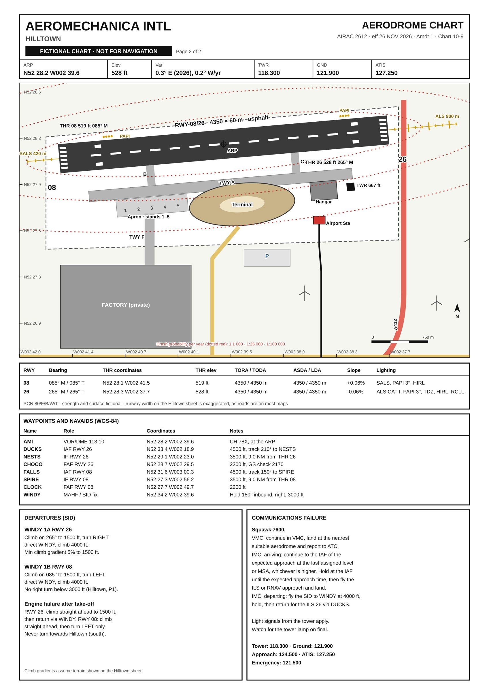

# Aeromechanica International

## The 1970s: Aeromechanica comes to town

After the 1968 flood, farmland north of the A49 was going cheap. Aeromechanica Airline Manufacturers needed somewhere to build and test aircraft, and bought the lot. The factory went up first, then a runway 4.35 km long, because the founder liked to be sure.

The terminal was built with a woven roof shaped like a bird's nest. The ducks moved in before the passengers did, and still regard it as theirs.

It was only meant to serve the factory. Then one foggy night a flight from Amsterdam was diverted in, and the town decided that one international arrival made it an international airport. Van der Molen would have approved. Aeromechanica International has been the name ever since.

The airport brought new rules. Aircraft may not fly over Hilltown below 4,000 feet, officially for safety and unofficially because a plane's shadow across the hill makes the sundial show the wrong time. Every go-around turns north, away from the town. The crash probability lines were drawn round the runway, and the wind turbines were moved out of the way.

The railway was extended to the terminal, and Hilltown finally had a reason to use London time. It still doesn't.

## The charts

!!! warning
    Fictional charts. Not for navigation.

<figure markdown>
[{ loading=lazy width="1697" height="2400" }](charts/aeromechanica-charts-a4.pdf)
<figcaption>Chart 10-1: approach and departure.</figcaption>
</figure>

<figure markdown>
[{ loading=lazy width="1697" height="2400" }](charts/aeromechanica-charts-a4.pdf)
<figcaption>Chart 10-9: aerodrome chart and data.</figcaption>
</figure>

[Download both charts (PDF, two A4 pages)](charts/aeromechanica-charts-a4.pdf)

## The aircraft

The aircraft are in the [Aeromechanica series](../series/aeromechanica.md): [Avis Aeromechanica Chocolatus](../series/aeromechanica.md) (2026), [Chocolatus Airframe Cutaway](../series/aeromechanica.md) and [Chocolatus Cockpit](../series/aeromechanica.md) (2026), [Aeromechanica Chocolatus Evolution](../series/aeromechanica.md) (2026), four panels dated 1972, 1976, 1985 and 2026, and [Aeromechanica Musculus](../series/aeromechanica.md) (2026), the cocoa-powered airliner climbing away from Aeroville.

