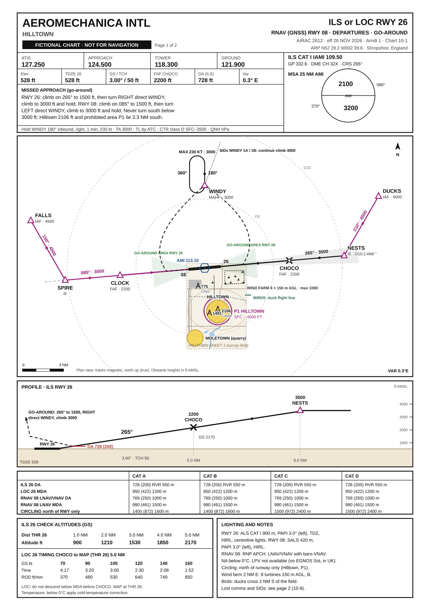

# Aeromechanica International

## 1917: the aerodrome

In 1917 the Royal Flying Corps needed somewhere flat to teach young men to fly, and the plain north of the town is very flat. They put up canvas hangars, mowed a strip and called it an aerodrome. Nobody asked the town, which took it as a compliment: someone in London had finally noticed the place.

The pilots learned on the plain and navigated by the hill, which is hard to miss. The ones who missed it anyway are remembered in the Clock Inn, mostly fondly. In April 1918 the Royal Flying Corps became the Royal Air Force, the sign at the gate was repainted, and nothing else changed.

Between the wars the hangars were let to a small firm that built aircraft nobody had asked for. The firm was Aeromechanica.

## 1939: the war sheets

In 1939 the Air Ministry came back, laid concrete over the grass and put up proper hangars. Aeromechanica moved into them and spent the war building aircraft for the Allies, each one drawn first on a specimen plate, as if it had been caught rather than made.

The other side's aircraft were built by Aeromechanik GmbH, a stand-alone division of the Aeromechanica Group. Stand-alone is doing a lot of work in that sentence. The two never shared a factory or a board meeting, but they did share a drawing style, a ruled title box and, by an accident nobody has explained, a scale of 1:72. Hilltown has always said it knew nothing about it. Moletown has always said Hilltown would say that.

When the war ended the concrete stayed. The town had an aerodrome it had never asked for, run by a company it did not entirely trust, and it would take another flood before anyone thought of making it an airport.

## The 1970s: the airport

After the 1968 flood, the farmland around the old aerodrome was going cheap. Aeromechanica Aircraft, by now building airliners rather than war sheets, needed room to build and test them, and bought the lot. The new factory went up first, then a runway 4.35 km long, because the founder liked to be sure.

The terminal was built with a woven roof shaped like a bird's nest. The ducks moved in before the passengers did, and still regard it as theirs.

It was only meant to serve the factory. Then one foggy night a flight from Amsterdam was diverted in, and the town decided that one international arrival made it an international airport. Van der Molen would have approved. Aeromechanica International has been the name ever since.

The airport brought new rules. Aircraft may not fly over Hilltown below 4,000 feet, officially for safety and unofficially because a plane's shadow across the hill makes the sundial show the wrong time. Every go-around turns north, away from the town. The crash probability lines were drawn round the runway, and the wind turbines were moved out of the way.

The railway was extended to the terminal, and Hilltown finally had a reason to use London time. It still doesn't.

## The charts

!!! warning
    Fictional charts. Not for navigation.

<figure markdown>
[{ loading=lazy width="1697" height="2400" }](charts/aeromechanica-charts-a4.pdf)
<figcaption>Chart 10-1: approach and departure.</figcaption>
</figure>

<figure markdown>
[{ loading=lazy width="1697" height="2400" }](charts/aeromechanica-charts-a4.pdf)
<figcaption>Chart 10-9: aerodrome chart and data.</figcaption>
</figure>

[Download both charts (PDF, two A4 pages)](charts/aeromechanica-charts-a4.pdf)

## The aircraft

The Chocolatus was built here, in the Aeromechanica Aircraft factory beside the runway. It is in the [Aeromechanica series](../series/aeromechanica.md): [Avis Aeromechanica Chocolatus](../series/aeromechanica.md) (2026), the [Chocolatus Airframe Cutaway](../series/aeromechanica.md) and [Chocolatus Cockpit](../series/aeromechanica.md) (2026), and [Aeromechanica Chocolatus Evolution](../series/aeromechanica.md) (2026), four panels dated 1972, 1976, 1985 and 2026.

The flagship, [Aeromechanica Musculus](../series/aeromechanica.md) (2026), was built here too. The painting shows the cocoa-powered double-decker climbing away from the runway at night, past the control tower.

