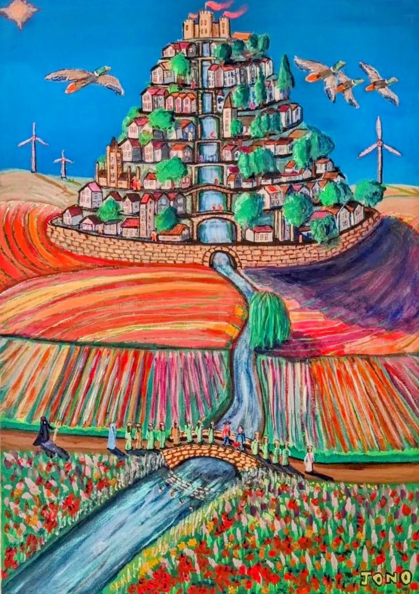

# Hill Town

Hilltown was founded in 1348, when the farmers of a fertile plain walled themselves onto a hill full of water to keep out the Black Death. The stone for the wall came from a pit at the foot of the hill, and the pit became Moletown. I painted the town twice, then drew the map, and the town kept growing from there.

<figure markdown>
{ width="2283" height="3708" }
<figcaption>Hill Town 1896. The town before the airport, when the Dutch windmills still turned. A1 · Acrylic &amp; Acryla Gouache · Canvas · 2026</figcaption>
</figure>

<figure markdown>
{ width="1063" height="1506" }
<figcaption>Hill Town 2026. The town today, with modern wind turbines in the Turbine Fields. A1 · Acrylic &amp; Acryla Gouache · Canvas · 2026</figcaption>
</figure>

-   **[History](history.md)**

    A short and mostly accurate history, from the plague wall of 1348 to the next flood in 2052.

-   **[The Ordnance Map](map.md)**

    The A2 map, three detail crops, the two ink sketches it grew from, and the print file.

-   **[Explore the map](explore.md)**

    The interactive map. Search it, tap places, switch layers and measure the walk.

-   **[Aeromechanica International](aeromechanica-international.md)**

    The airport, its story and its pilot charts.

