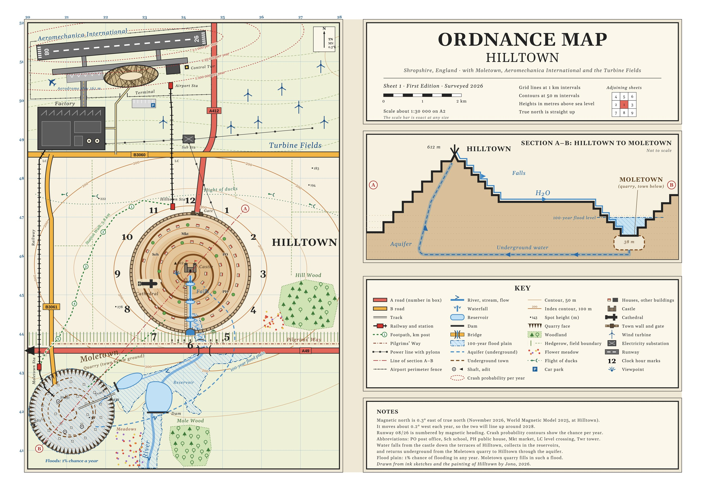
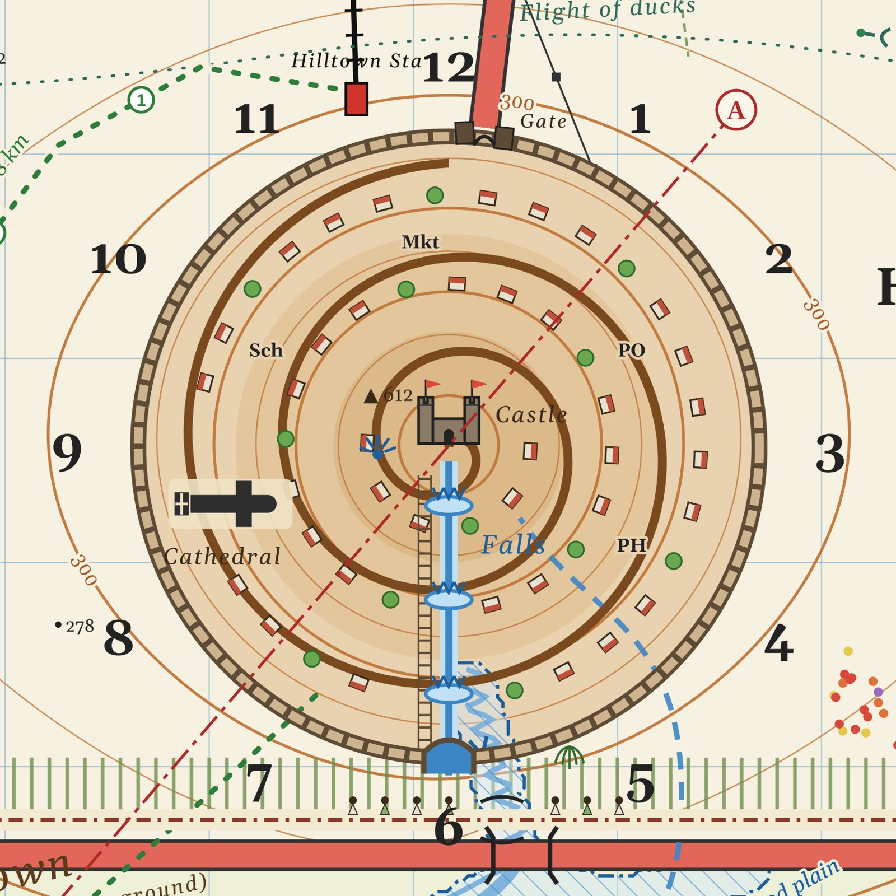
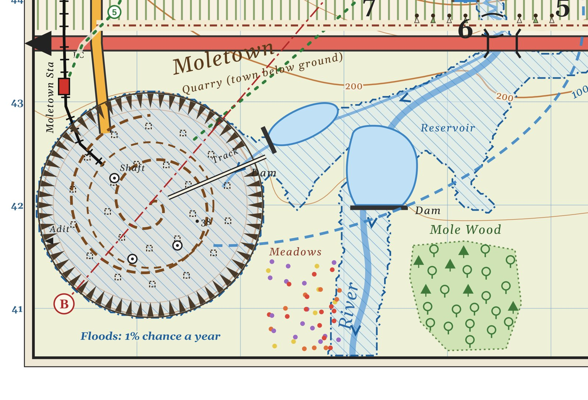
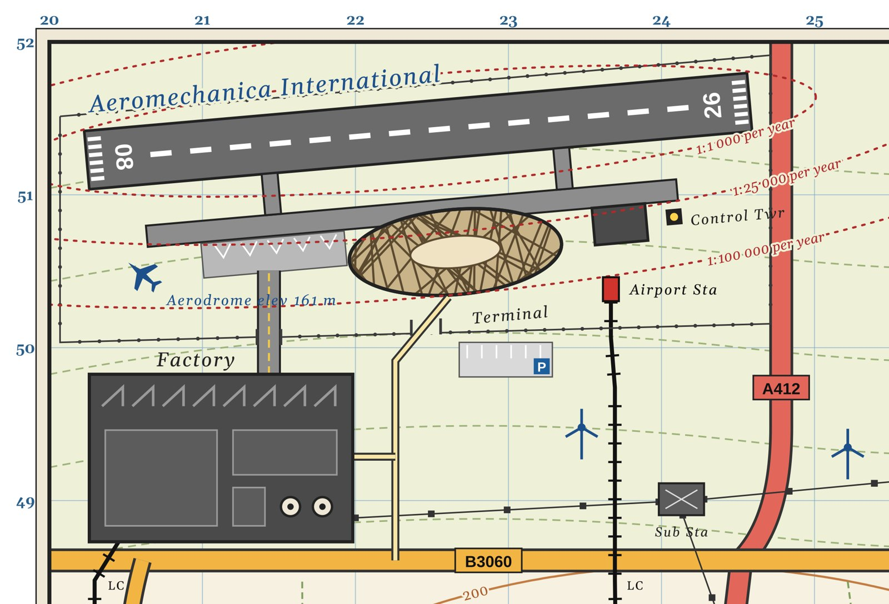
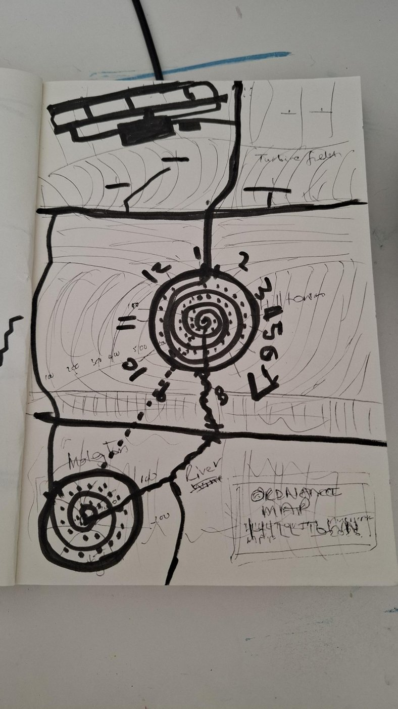
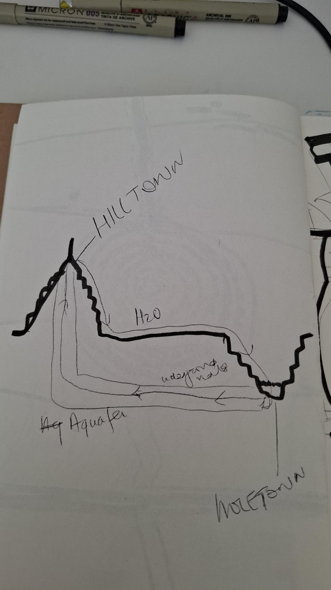

# The Ordnance Map

[{ width="2800" height="1979" }](maps/hilltown-ordnance-map-a2.pdf)

[Download the A2 print file (PDF)](maps/hilltown-ordnance-map-a2.pdf)

## Details

<figure markdown>
{ loading=lazy width="1600" height="1600" }
<figcaption>Hilltown: the wall, the clock spiral, the castle, the falls and St Jude's Cathedral.</figcaption>
</figure>

<figure markdown>
{ loading=lazy width="1600" height="1091" }
<figcaption>Moletown: the quarry, the reservoirs and the 100-year flood plain.</figcaption>
</figure>

<figure markdown>
{ loading=lazy width="1600" height="1088" }
<figcaption>Aeromechanica International: the runway, the factory and the rail station.</figcaption>
</figure>

## From sketch to map

The map grew from two ink drawings and the painting. The first sketch fixed the plan of the town, the second cut through the hill to show where the water goes.

<figure markdown>
{ loading=lazy width="788" height="1400" }
<figcaption>Sketch 1: the plan.</figcaption>
</figure>

<figure markdown>
{ loading=lazy width="788" height="1400" }
<figcaption>Sketch 2: the cross-section, with the water cycle.</figcaption>
</figure>

## Printing it

Print the PDF on A2 landscape, on matt paper, at 100% (actual size), not "fit to page". On A2 the scale is about 1:30 000. The scale bar is exact at any size.

